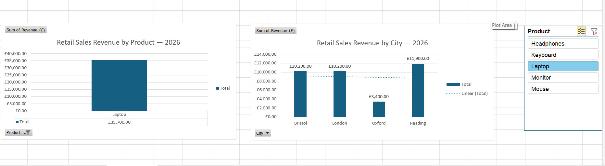

# Retail Sales Performance Analysis Using Generative AI

## Project Overview
This project analyses a sample retail sales dataset using Microsoft Excel and ChatGPT to understand revenue trends and product performance.

## Business Problem
A retail business wants to identify its highest-revenue products, strongest sales months and opportunities to improve performance.

## Dataset
- 60 sample sales transactions
- Period: January to June 2026
- Columns: Order ID, Date, Month, City, Product, Units, Unit Price and Revenue

## Tools
- Microsoft Excel
- ChatGPT
- Prompt Engineering
- SQL 

## Analysis
- Total revenue: £50,770
- Total orders: 60
- Highest-revenue product: Laptop (£35,700)
- Highest-revenue month: June (£11,620)

## Method
1. Check data quality and revenue calculations.
2. Analyse sales by month, product and city in Excel.
3. Test structured ChatGPT prompts on the dataset.
4. Validate AI-generated answers against Excel.
5. Visualise trends and document business insights.

## Prompt Engineering
The project compares basic and structured prompts to assess the usefulness and accuracy of AI-generated analysis. Prompt testing and validation evidence will be added as the project progresses.

## Project Status
In progress — Excel analysis available; dashboard, prompt comparison and SQL exercises are being developed.

## Data Note
This is a synthetic educational dataset, not actual company sales data.

## Excel Data Analytics and Interactive Dashboard

### Project Overview
Analysed 60 retail sales orders using Microsoft Excel to understand product performance, city-wise revenue and sales trends.

### Excel Skills Demonstrated
- **Formulas:** SUM, COUNTA, AVERAGE, MAX, MIN, SUMIF, COUNTIF, SUMIFS, COUNTIFS, AVERAGEIF, XLOOKUP and IF.
- **Pivot Tables:** Analysed revenue and units sold by product and city.
- **Pivot Charts:** Created visual comparisons of product revenue and city revenue.
- **Interactive Slicers:** Enabled product-based filtering across multiple Pivot Charts.
- **Dynamic KPIs:** Developed three indicators that update with the selected product.

### Key Findings
- Total Sales Revenue: £50,770
- Total Orders: 60
- Total Units Sold: 210
- Highest-Revenue Product: Laptop (£35,700)
- Highest-Revenue City: London (£15,400)

### Interactive Excel Dashboard

### Project Files
- `retail_sales_project.xlsx` — Excel calculations, Pivot Tables, Pivot Charts and dashboard.
- `Retail_Sales_Dashboard.png` — Screenshot of the dashboard.

### Tools Used
Microsoft Excel, Pivot Tables, Pivot Charts, Excel Formulas and GitHub.
