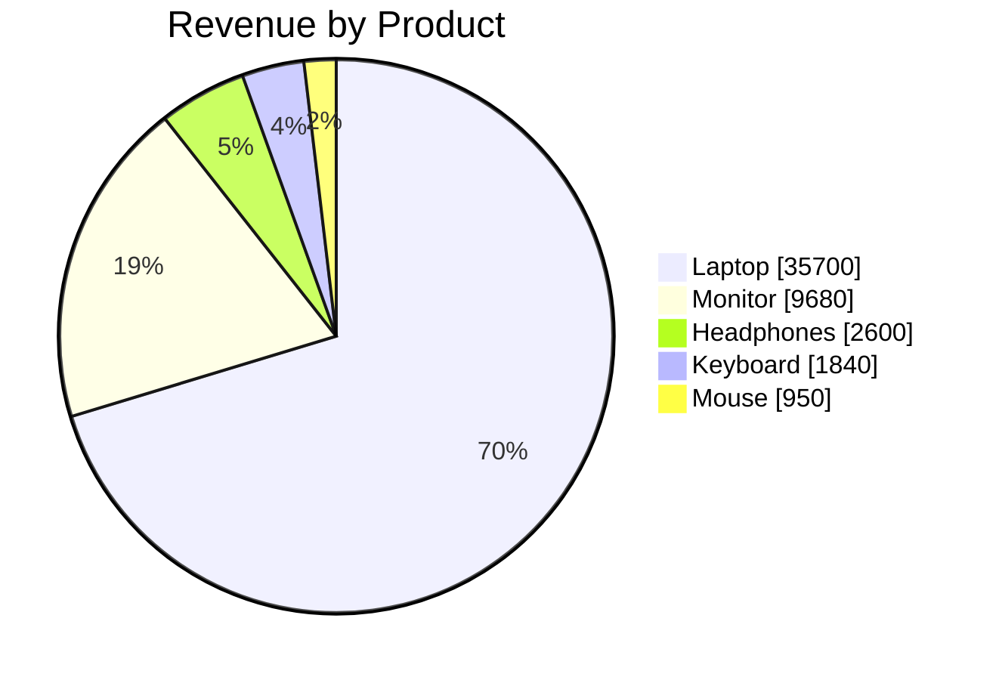
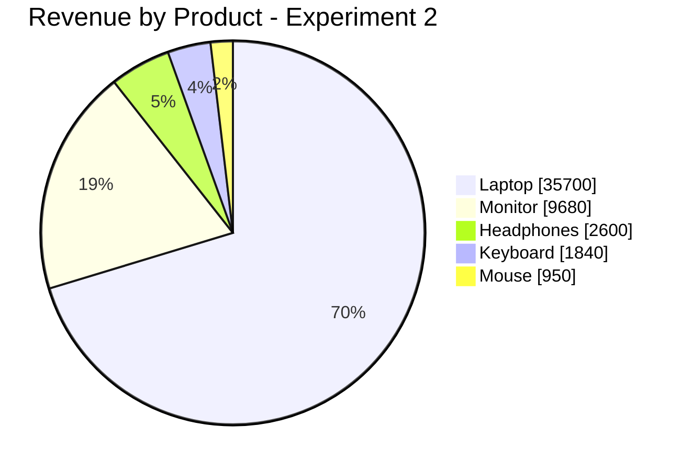

# Prompt Engineering Experiment Log

## Project Objective
To analyse retail sales data using ChatGPT and
understand how prompt quality affects AI responses.

## Experiment 1: Basic Prompt

### Prompt
Analyse my retail sales data.

### AI Response
#To be added after testing.

Total Revenue: £50,770
- Total Orders: 60
- Total Units Sold: 210
- Best-Selling Product by Revenue: Laptop (£35,700)
- Highest-Revenue Month: June (£11,620)
- Highest-Revenue City: London (£15,400)

### Observations
The basic prompt produced a sales summary, charts and business insights without specifying the exact output format.

However, the prompt did not define which analyses were required or how results should be presented.

### Learning
A basic prompt can produce useful insights, but a structured prompt gives greater control over the analysis and presentation.

### Experiment 1 — Sales Pie Chart

## Experiment 2: Structured Prompt

### Prompt
Act as a professional Retail Data Analyst.

Analyse the attached Excel sales dataset.

Identify:
1. Total sales revenue.
2. Highest-revenue product.
3. Best-performing month.
4. Sales performance by city.
5. Three business recommendations.

Present your results in tables.
Show calculations.
Use only the provided dataset.
Do not invent information.

### AI Response
To be added after testing.

Expected values for comparison:

| Metric | Value |
|---|---:|
| Total Revenue | £50,770 |
| Total Orders | 60 |
| Total Units Sold | 210 |
| Highest-Revenue Product | Laptop (£35,700) |
| Highest-Revenue Month | June (£11,620) |
| Highest-Revenue City | London (£15,400) |

### Observations
To be added after testing.

## Comparison and Validation

The results from both prompts will be compared
against Excel calculations for accuracy,
completeness and clarity.

## Conclusion
#To be completed after testing both prompts.
Experiment 2 demonstrated how structured prompt engineering can guide ChatGPT to produce clear, detailed and business-focused analysis.

By specifying the AI's role, tasks, output format and constraints, the analysis provided:

Accurate sales calculations and structured tables.

Identification of the highest-revenue product, month and city.

Clear business insights and practical recommendations.

Better control over the presentation of results.

Key Learning: Structured prompting helps generate more organised, relevant and actionable outputs. It also makes the results easier to evaluate and validate.
